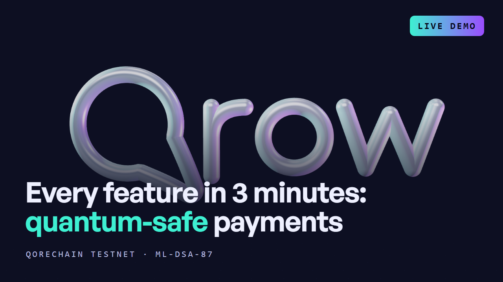

# Qrow

**Escrow payments, swaps, NFTs, staking and trading on QoreChain, every action signed with a quantum-safe key.**
Public beta on QoreChain testnet (`qorechain-diana`, EVM chain 9800). Testnet tokens have no value.

**Live: https://qrow-app.vercel.app** (desktop, or on a phone inside the QoreX app's dApp browser).

Built for the QoreChain *Build Before Q-Day* Developer Fest, Post-Quantum dApp category.

## Demo video (2:46)

[**Watch the demo on YouTube**](https://youtu.be/jJAJjqx_9sY): a 3D intro, then every feature in the live app with
real clicks and typing, on the builder's own testnet wallet in a read-only view (nothing is signed on camera; each
action stops at its review step, where QoreX would ask for approval).

Full-quality MP4 file: [media/qrow-demo.mp4](media/qrow-demo.mp4)

## What you can try

| Tab | What it does |
| --- | --- |
| **Hub** | Every feature in one place, with your balance, live prices and open prediction markets |
| **Faucet** | Free test QOR, fUSD, fETH and fBTC from QoreChain's official faucet |
| **Swap** | QoreChain's built-in exchange: the chain quotes the price, minimum received, fee and price impact before you sign |
| **Trade** | Perpetual positions up to 100x on live prices (ETH, SOL, BNB, QOR), with take-profit and stop-loss |
| **Predictions** | Back YES or NO on crypto and QoreChain questions; prices show the odds |
| **Send** | Money waits in escrow until the recipient claims it, or comes back after 7 days; lookalike-address checks before you sign |
| **Receive** | Claim payments, read encrypted notes (QoreSeal, ML-KEM-1024), share a payment link or QR code |
| **NFT Shop** | Mint Qrow Genesis: 256 pieces of generative art drawn on chain |
| **Create NFT** | Upload your own art and mint an edition of up to 10,000 copies |
| **NFT Market** | List at your own price, see the floor, buy or cancel |
| **Portfolio** | Balances, NFTs and payments in escrow, read from the chain, with CSV export |
| **History** | Every transaction from your wallet, read from the chain (any device), each with a hash to verify |
| **Staking** | Delegate QOR to a validator, lock it for a bonus |
| **Launch** | A testnet memecoin with anti-scam rules built in, such as a fixed supply |
| **Market News** | Live prices (CoinMarketCap) and the latest crypto headlines |
| **Verify** | Paste any hash or Qrow reference: status, signer, the ML-DSA-87 check the chain ran, and what each step did |
| **Admin & Analytics** | Live Qrow numbers from the testnet |

## How signing works (post-quantum by design)

- **QoreX approves every transaction.** Native actions (swaps, staking, transfers) are signed in QoreX with its
  hybrid secp256k1 + ML-DSA-87 signature. Contract actions (send, mint, list, trade, predict, launch) each ask QoreX
  first for a permission that lasts ten minutes and names the action in its memo, so nothing runs on an old approval.
- **A device key does the contract call.** QoreX can't sign cross-VM contract calls for websites yet, so each
  browser keeps a Qrow device account behind a passkey, with its own registered ML-DSA-87 key. Within the approval
  QoreX just gave, it runs the call as the user (`authz` `MsgExec` of a `MsgCrossVMCall`), inside an EVM window that
  caps what Qrow may do. Users never see, copy or save a key, recovery phrase or code.
- **The contracts check the quantum-safe signature.** Every sensitive action carries an ML-DSA-87 signature verified
  on chain with QoreChain's `pqcVerify` precompile. A leaked classical key alone can't move anything.
- **Receipts you can check yourself.** Every action ends with a receipt and its hash; History and Verify read them
  straight from QoreChain, never from a Qrow database.

## Contracts (testnet)

| Contract | Address |
| --- | --- |
| QrowKeys (device keys) | `0xa5242cb348eddef0deb9599f81e55a64d186fd14` |
| QrowEscrow (payments) | `0x332937d1918a0f85eacc5167ab87ba91c48a4655` |
| QrowGenesis (NFT Shop) | `0x5f03380be788bbd17eb3529b77ee27bed879602d` |
| QrowMarket (NFT Market) | `0x10e2e663ebb1fdd290b8cabbe6e2634852d65fa9` |
| QrowCoinFactory (Launch) | `0x764a8586e7a7e9e2b511bf79d9f9c8b3ae7e7c5e` |
| QrowEditions (Create NFT) | `0x463e5c38523a0f22264380bc2eeed10615d185c0` |
| QrowPredict (Predictions) | `0x4bcf3b1bbd1ad5ec15e668e646b8a1569551a2c9` |
| QrowPerps (Trade) | `0x4a4df4cdbb9c0ee0ae465124bc8b5caabf15bb85` |

Deployment details and on-chain test transactions: [`contracts/deployments/testnet.json`](contracts/deployments/testnet.json),
[`docs/TEST_NOTES.md`](docs/TEST_NOTES.md).

## How to verify any Qrow transaction

1. Copy the transaction hash Qrow shows (receipts, History, CSV exports).
2. Open the app's **Verify** page (https://qrow-app.vercel.app/verify), no wallet needed. It also takes an explorer
   link or a Qrow reference (`QRW-PAY-000123` for a payment, `QRW-NFT-000045` for an NFT).
3. Or search it on [explore.qore.network](https://explore.qore.network) (switch the explorer to **Testnet**), or ask
   the chain directly: `https://api-testnet.qore.host/cosmos/tx/v1beta1/txs/<hash>`. A Qrow contract action shows a
   `crossvm_request` event whose `target_contract` is one of the contracts above, plus `pqc_hybrid_verify: verified`.

## Repository

| Folder | What |
| --- | --- |
| `contracts/` | Solidity (Foundry), tests, testnet scripts |
| `web/` | The app (Vite, React, wagmi, viem, RainbowKit) |
| `agent/` | Server: agent API (prices, news, referrals, wording) and the REST relay |
| `watcher/` | Telegram alerts for escrow events |
| `video/` | The demo video pipeline: Playwright recordings, edge-tts voice, Three.js intro, HyperFrames, ffmpeg |
| `media/` | The demo video and its thumbnail |
| `docs/` | Plan, test notes, deployment, AI usage log |

Run the tests: `cd contracts && forge test`, `cd web && npm test`, `cd agent && npm test`, `cd watcher && npm test`.

Rebuild the demo video: see [`video/demo`](video/demo) (`record_demo.py`, `voice.py`, `capture_intro.py`,
`capture_cards.py`, `assemble_demo.py`).

## About the builder

Built solo by **Terhemba Jonathan Alumo** ([GitHub: Terhemba10](https://github.com/Terhemba10)) in **Doha, Qatar**,
for QoreChain's *Build Before Q-Day* Developer Fest, representing the **Middle East & Africa** region.
Qrow is an independent community project: it uses QoreChain's public kits and the QoreX palette, never QoreChain's
or QoreX's logos.

## Credits

Every library below is used under its own licence; Qrow's own code is MIT.

| Used | Licence | For |
| --- | --- | --- |
| QoreChain SDK, `@qorechain/evm`, `qoresign`, `qoreseal`, `qorex-types`, `qorex-rainbowkit` | Apache-2.0 | Chain access, PQC keys and signatures, QoreSeal, QoreX |
| QoreChain custody kit (address validation, vendored in `web/src/vendor/custody-kit`) | Apache-2.0 | Address checks (LICENSE and NOTICE kept) |
| `create-qorechain-dapp` templates (viem-wagmi, foundry) | Apache-2.0 | Starting points for `wagmi.ts`, `vite.config.ts`, `scripts/window.ts` |
| OpenZeppelin Contracts 5.6.1 | MIT | ERC-20, ERC-721, ReentrancyGuard |
| forge-std | MIT / Apache-2.0 | Contract tests |
| viem, wagmi, RainbowKit, TanStack Query, React, React Router | MIT | Web app |
| qrcode | MIT | QR codes |
| @bufbuild/protobuf | Apache-2.0 / BSD-3-Clause | Encoding the token-convert messages the SDK doesn't build |
| Anthropic TypeScript SDK | Apache-2.0 | Plain-language wording on the agent server |
| tsx | MIT | Running the servers |
| CosmJS (`@cosmjs/stargate`) | Apache-2.0 | Native-lane scripts |
| General Sans (Fontshare, ITF free font licence) | loaded from Fontshare, not redistributed | Interface type |
| Geist Mono, IBM Plex Sans Arabic | SIL OFL 1.1 (Google Fonts) | Figures and addresses, Arabic |
| CoinMarketCap API | CoinMarketCap terms | Market prices ("Data from CoinMarketCap") |
| Cointelegraph, Decrypt, The Block RSS feeds | their terms | Headlines with links (titles only) |
| Playwright | Apache-2.0 | Recording the demo video (video tool only) |
| Three.js r170 | MIT | The demo's 3D intro (video tool only) |
| HyperFrames, GSAP | Apache-2.0 / GSAP standard licence | Video compositions (video tool only) |
| edge-tts (Microsoft Edge neural voice, en-US-AndrewNeural) | LGPL-3.0, owner-approved exception | Demo voiceover (video tool only, not an app dependency) |
| "Good Days" by Aylex | Free To Use licence | Demo music. Music from Free To Use / Source: https://freetouse.com/music / Good Days by Aylex |
| Claude (Anthropic) | | Development assistant; see [`docs/AI_LOG.md`](docs/AI_LOG.md) |

Demo voiceover: AI-generated.

## Licence

MIT, see [LICENSE](LICENSE).
